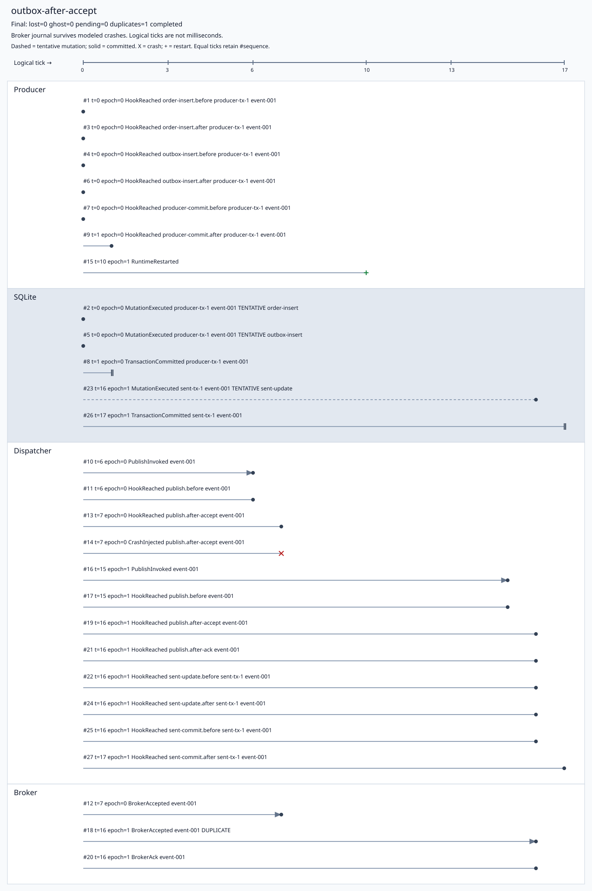

# Transactional Outbox Fault Lab

CLI that runs three manual publishing strategies against file-backed SQLite and a deterministic in-memory broker. Inject application crashes at exact boundaries and inspect committed data, broker acceptances, recovery, and duplicate effects.

```bash
dotnet restore TransactionalOutboxFaultLab.slnx --locked-mode
dotnet build TransactionalOutboxFaultLab.slnx -c Release --no-restore
dotnet test TransactionalOutboxFaultLab.slnx -c Release --no-build
dotnet run --project src/OutboxFaultLab.Cli -c Release --no-build -- demo --output artifacts/demo
```

Requires the .NET SDK pinned in `global.json` (10.0.401, latest patch roll-forward). No broker server, cloud account, paid API, ORM, or transaction coordinator is needed.

These are actual demo results generated by the application:

| Case | Committed orders | Accepted deliveries | Lost | Ghost | Pending | Duplicates |
|---|---:|---:|---:|---:|---:|---:|
| db-first-lost | 1 | 0 | 1 | 0 | 0 | 0 |
| publish-first-ghost | 0 | 1 | 0 | 1 | 0 | 0 |
| outbox-before-dispatch | 1 | 1 | 0 | 0 | 0 | 0 |
| outbox-after-accept | 1 | 2 | 0 | 0 | 0 | 1 |

Every case above passes its expected experiment outcome. Expected loss or ghost publication in an unsafe strategy is a successful reproduction of that failure.

[Executed comparison CSV](examples/demo-results.csv) · [Duplicate-case summary](examples/outbox-after-accept/summary.json) · [Full trace](examples/outbox-after-accept/trace.json) · [Consumer results](examples/consumer-summary.json)

The following SVG comes from the executed outbox-after-accept case. Rows are grouped by ownership lane; horizontal position measures logical time. Sequence labels preserve global ordering across lanes and tied ticks.



DB-first commits the order before publishing: a crash between those effects leaves an order with an unrecoverable missing event. Publish-first can accept an event before the order commits, leaving a ghost event after rollback. The outbox inserts the order and immutable event payload in the same SQLite transaction. A fresh dispatcher selects the oldest persisted unsent row, publishes outside the read connection, and commits its sent marker only after acknowledgement.

An acceptance followed by a crash or lost acknowledgement leaves durable intent pending. Retrying may accept the same EventId again. The broker deliberately retains duplicates. The separate idempotent consumer atomically stores its ProcessedEvents record and projection effect; two accepted deliveries apply twice in naive mode and once in idempotent mode. This guarantees deduplicated effects inside that consumer database; emails, HTTP requests, and payments outside it need their own solution.

```bash
dotnet run --project src/OutboxFaultLab.Cli -c Release --no-build -- run --scenario scenarios/outbox-after-accept.json --output artifacts/one
dotnet run --project src/OutboxFaultLab.Cli -c Release --no-build -- matrix --output artifacts/matrix
dotnet run --project src/OutboxFaultLab.Cli -c Release --no-build -- consumer-demo --output artifacts/consumer
dotnet run --project src/OutboxFaultLab.Cli -c Release --no-build -- run --scenario scenarios/outbox-budget-exhausted.json --output artifacts/exhaustion
```

Use a fresh output directory for each run, or add `--overwrite` to replace registered lab reports. Existing unrelated files are preserved. Temporary databases live in isolated directories and are removed after connections close. `demo` and `matrix` locate shipped fixtures beside the executable and work from another working directory. `run --scenario` resolves the explicit file path from the current directory. `--help` lists the small command surface.

Each case writes `summary.json`, `trace.json`, `snapshots.json`, `results.csv`, and `timeline.svg`. Demo and matrix also write `matrix.csv` and `matrix-summary.json`. Consumer-demo writes `consumer-summary.json` and separate naive/idempotent SVGs. Reports use schemaVersion=1, UTF-8, LF, stable ordering, and no machine paths or wall-clock metadata. They can be compared byte-for-byte. See [report definitions](docs/reports.md).

| Metric | Meaning |
|---|---|
| missingEvents | Committed orders whose expected event has no acceptance |
| recoverablePendingEvents | Missing events with an unsent outbox row |
| lostEvents | Missing events without durable pending intent |
| ghostEvents | Distinct accepted events whose order did not commit |
| duplicateDeliveries | Acceptances minus distinct accepted EventIds |
| pendingOutboxRows | All unsent rows, including accepted events with stale markers |
| publishAttempts / publishRetries | Invocations, including crashes before publication / invocations after the first per EventId |
| attemptedRowMutations / committedRowMutations | Executed row writes / writes in committed transactions |
| extraWrites | Committed mutations minus committed orders |
| transactionCommits / restartCount | Actual workload commits / actual harness restarts |
| deliveryLatencyTicks | First acceptance minus business commit; publish-first may be negative |
| recoveryLatencyTicks | First acceptance minus first restart with a committed missing event |
| recoveryDrainTicks | Last sent-marker commit minus first restart with pending rows, only when drained |

Undefined latency is JSON null and a blank CSV field. Logical ticks are not milliseconds or benchmark measurements. A stale marker can have null recovery latency because acceptance already happened, while recoveryDrainTicks measures closure of that marker gap. Finite-budget exhaustion leaves pending work unresolved, rather than classifying it as lost.

Exit codes: `0` expectations and invariants passed (including explicitly expected unresolved fixtures); `1` verification or unexpected runtime/storage/report failure; `2` invalid arguments/scenario/output path; `3` unresolved work without an explicit unresolved expectation. In matrix mode, verification failure takes precedence.

Failures use exceptions after named operations; stack unwinding disposes transactions before a new connection reads snapshots. The harness retains logical time, fault occurrence counters, broker cursor/journal, trace, and global budgets. A restart creates fresh runtime objects and connections. The producer command is executed once and never replayed. The broker is assumed to survive these application failures. This models completed atomic SQLite commits and disposal rollback, not process termination, physical power loss, or a broker outage that destroys accepted messages. See [architecture and failure model](docs/architecture.md).

Validated natively on 2026-10-03: locked restore, Release build with zero warnings/errors, **86 tests passed with no skips**, **30/30 matrix cases** (27 crashes + 3 baselines), all **10 named fixtures**, consumer-demo, published CLI, and byte-for-byte matrix/consumer reproducibility. Generated demo SVGs were parsed and visually inspected. [Implementation evidence](docs/validation.md) records commands and limitations.

The optional Docker recipe pins SDK/runtime image digests. Docker is unavailable on the validation machine, so the Docker build was not run:

```bash
docker build --target verify -t outbox-fault-lab-verify .
docker build --target runtime -t outbox-fault-lab .
docker run --rm outbox-fault-lab demo --output /tmp/outbox-demo
```

For retained output on Linux/WSL, mount only an output directory as described in [Docker instructions](docs/development.md). GitHub Actions runs locked restore, Release build, tests, matrix, and artifact upload; CI action revisions are pinned. CI itself runs after the code is committed and pushed.

The application validates custom scenarios with [the JSON schema](schemas/scenario.schema.json). The [expected matrix](expected/single-crash-matrix.csv) supplies independent assertions; expected metrics never control execution. No Python runtime is required.

[Architecture and failure model](docs/architecture.md) · [Scenario configuration](docs/scenarios.md) · [Report definitions](docs/reports.md) · [Development and verification](docs/development.md) · [Validation evidence](docs/validation.md)

Run all native gates with `./scripts/verify.ps1` on Windows or `bash scripts/verify.sh` on Linux/WSL. The helpers generate reports in a fresh temporary directory and print its location.
